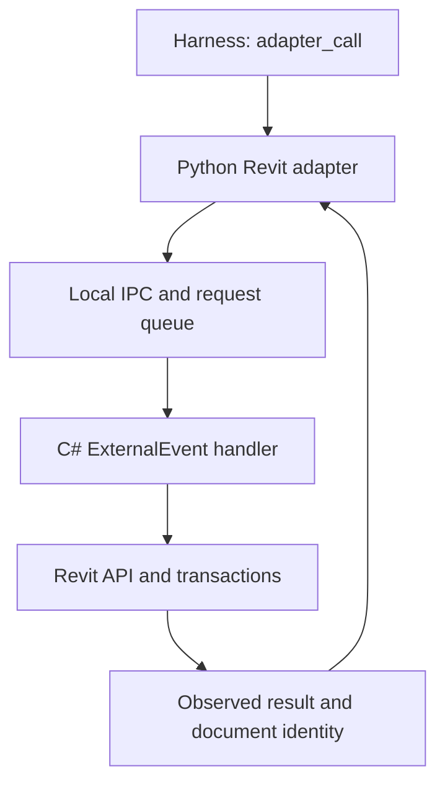

# Больше способов управления рабочим ПК

Проверено по коду `main` на 19 октября 2026 года. Исходная версия — `0.2.3`.
Этот документ разделяет возможности, добавленные в текущую ветку, и следующий
этап разработки. Установка на конкретный Windows-ПК требует отдельного smoke
теста; наличие кода не означает, что приложение уже подключено.

## Что уже было

Harness уже содержит основные способы управления: процессы и команды, дерево
UI Automation, Win32, COM, Playwright и загрузку Python-адаптеров. Встроенный
прикладной адаптер сейчас один — AutoCAD. Revit-адаптера и подключения к обычным
вкладкам личного браузера в этой реализации нет.

Поэтому следующий шаг — сделать каждое действие точным и проверяемым:
выбрать конкретное приложение или вкладку, прочитать состояние, выполнить
поддерживаемую операцию, проверить результат.

## Что добавляет эта ветка

| Возможность | Практическое изменение |
|---|---|
| Устойчивый `tab_id` | Закрытие соседней вкладки не меняет адресата команды. Для закрытого ID возвращается ошибка. |
| `frames` и выбор frame | Можно исследовать и заполнить форму внутри iframe, включая вложенные frame. |
| Строгий locator | Несколько подходящих элементов дают ошибку; выбор `nth` должен быть явным. |
| Browser `inspect` | Видны значение, checkbox state, required/readonly/disabled, варианты native select; пароль скрыт. |
| `selectOption`, `setChecked` | Стандартные формы доступны без произвольного JavaScript и экранных координат. |
| `hover`, `scrollIntoView` | Можно открыть меню наведением и прокрутить до элемента через DOM. |
| Очередь Browser Bridge | Параллельные HTTP/stdio запросы не запускают два browser context и не перемешивают действие с сохранением состояния. |
| `uia_inspect` | Видны поддерживаемые UIA patterns и доступное состояние: value/text/toggle/selection/expansion/range. |
| Исправленный `uia_wait` | Ожидание появления/исчезновения работает на WindowSpecification до получения wrapper. |
| Владение COM/UIA потоками | COM handles живут на своём STA-потоке, UIA выполняется отдельно на MTA-потоке. |
| `desktop_browser`, `desktop_inspect` | Частые сценарии доступны непосредственно в списке MCP tools. |

Полные параметры возвращает `desktop_describe`. Тот же код доступен через
`pc-agent` и существующий `desktop_action`; новый MCP-клиент не обязателен.

### Пример: заполнить форму и проверить её

Следующие JSON — отдельные вызовы Desktop Agent. Реальные `tab_id`, frame и
locator берутся из предыдущих ответов, а не угадываются:

```json
{"action":"browser","payload":{"action":"tabs"}}
```

```json
{"action":"browser","payload":{"action":"snapshot","tab_id":"<tab_id из tabs>"}}
```

```json
{"action":"browser","payload":{"action":"frames","tab_id":"<tab_id из tabs>"}}
```

```json
{"action":"browser","payload":{"action":"fill","tab_id":"<tab_id из tabs>","frame_selector":"#request-form","label":"Project name","exact":true,"value":"Demo project"}}
```

```json
{"action":"browser","payload":{"action":"selectOption","tab_id":"<tab_id из tabs>","frame_selector":"#request-form","label":"Discipline","value":"architecture"}}
```

```json
{"action":"browser","payload":{"action":"setChecked","tab_id":"<tab_id из tabs>","frame_selector":"#request-form","label":"Include linked models","checked":true}}
```

```json
{"action":"browser","payload":{"action":"inspect","tab_id":"<tab_id из tabs>","frame_selector":"#request-form","label":"Project name"}}
```

`inspect` проверяет состояние элемента. Для доказательства сохранения на сайте
нужно ещё проверить результат самого сайта: номер заявки, страницу результата
или сохранённую запись. Успешный `fill` этого не доказывает.

### Пример: прочитать состояние обычного окна

```json
{"action":"uia_inspect","window":{"title_re":"Notepad","pid":1234},"control":{"control_type":"Edit"},"max_text":4000}
```

PID и selector надо получить через `windows` и `uia_tree`. Если приложение
экспортирует Toggle или SelectionItem, для существующего `uia_call` можно
выбрать соответствующий семантический wrapper-метод. Если нужного pattern нет,
ответ должен направлять к адаптеру/другому контролу/визуальному просмотру.

Python-адаптеры выполняются на COM STA. Для UIA внутри адаптера используйте
`context['uia_action']({...})`: callback выполняет запрос на UIA MTA и возвращает
обычный JSON. Прежние `context['find_uia']` и `context['window_info']` внутри
адаптера теперь возвращают понятную ошибку; raw wrappers нельзя переносить
между COM apartments. Встроенный AutoCAD adapter эти helpers не использует.

## Что означает управление «через память»

Нужный результат — получить осмысленное внутреннее состояние приложения:
ячейки Excel, документы AutoCAD, элементы и параметры Revit, форму браузера.
Предпочтительный способ — документированный object model приложения через
SDK, COM или небольшой плагин с IPC. Это даёт имена объектов, типы, идентичность
и допустимые операции.

Windows `ReadProcessMemory` действительно позволяет читать байты памяти
процесса при наличии соответствующего доступа. Но байты не дают стабильную
схему BIM-модели: адреса и внутреннее представление меняются, а корректность
изменений обеспечивается самим приложением. Для универсального harness это
означает отдельный reverse engineering каждой версии. Такой модуль имеет
смысл как узкая диагностика собственного приложения; он не заменяет API.

Сравнение для Revit: `ElementId -> Parameter -> Set` через API сразу задаёт
смысл действия. Адрес в RAM не сообщает, какой параметр допустимо менять и
какие связанные объекты Revit должен пересчитать.

## Следующие этапы

### 1. Подключить обычные вкладки браузера

Встроенный bridge управляет отдельным persistent profile. Для сценария
«продолжи в моей уже открытой вкладке» первым пилотом стоит подключить
официальный Playwright MCP с его extension mode как второй локальный MCP
сервер. Он поддерживает существующие вкладки и активные сессии Chrome/Edge.

После проверки реальных задач можно добавить backend-адаптер за теми же
контрактами target/action/result. Одну вкладку одновременно должен изменять
один исполнитель. Не нужно сначала писать собственные extension, native host
и протокол повторного подключения, если готовый transport закрывает задачу.

Chrome начиная с версии 136 не применяет remote debugging flags к обычному
default user-data directory. Для CDP нужен отдельный non-default каталог
профиля; extension mode решает другой сценарий — работу с выбранной текущей
сессией. Копирование cookies и отключение защиты браузера не требуется.

### 2. Добавить обнаружение приложений и запуск с проверкой готовности

`launch`, `processes`, `probe_target` уже есть. Следующее полезное расширение:

- `app_list`: установленные приложения, разрешённые executable paths,
  зарегистрированные adapters и доступность каждого способа управления;
- `app_open`: приложение или документ, аргументы отдельным массивом;
- `app_wait_ready`: PID/окно или ответ прикладного API, timeout и причина
  неготовности;
- `app_attach`: привязка к выбранному экземпляру, когда открыто несколько окон.

Запуск процесса ещё не означает, что окно/документ готов. Некоторые launcher
процессы завершаются и передают работу дочернему или уже открытому процессу;
проверка должна опираться и на состояние приложения.

### 3. Revit: добавить C# плагин и тонкий Python adapter



Сначала достаточно шести операций:

| Операция | Результат |
|---|---|
| `status` | Версия Revit, идентичность документа, вид, readonly/busy |
| `selection` | Выбранные ElementId, категории, основные параметры |
| `query_elements` | Ограниченная выборка по категории и параметрам |
| `get_parameters` | Значения, типы, единицы и readonly-флаги |
| `set_parameters` | Проверенный пакет изменений в именованной Transaction |
| `export` | Явные настройки, путь и проверенный файл результата |

RPC приходит в очередь плагина, который вызывает `ExternalEvent.Raise()`.
Revit выполняет handler в допустимом API-контексте. Нельзя вызывать Revit API
на произвольном Python/HTTP-потоке. Для записи проверяются документ, текущие
значения, типы параметров и допустимость транзакции. Transaction позволяет
откатить незавершённый пакет; она не откатывает уже отправленные внешние данные.

Revit API assemblies и runtime плагина нужно собирать под поддерживаемые версии
Revit. Первый тест — копия небольшой учебной модели: прочитать выборку,
изменить один тестовый параметр, прочитать его обратно, выполнить rollback.

### 4. Длительные задания и восстановление

Для экспорта, расчёта и массовых изменений нужны `job_start`, `job_status`,
`job_cancel` с состояниями queued/running/completed/failed/cancel_requested.
Отмена — запрос; backend обязан сообщить, действительно ли удалось остановить
операцию. HTTP timeout не означает отмену.

Общий будущий контракт:

```json
{
  "request_id": "caller-generated-id",
  "target": {"application":"revit","document_id":"observed-document-id"},
  "operation": "set_parameters",
  "preconditions": {"document_version":"observed-version"},
  "timeout_ms": 30000,
  "result": {"status":"completed","method":"revit_api","verified":true}
}
```

Это предложение, а не реализованный universal job API. Для операций с внешним
эффектом нужен журнал результата по `request_id`: потеря ответа после submit
не должна приводить к повторной отправке. Сначала определить итог операции;
если он неизвестен, вернуть `outcome_unknown`.

## Проверка и границы текущей реализации

Автотесты проверяют контракты, очереди, точный выбор вкладок/frames, формы на
локальной HTML fixture и UIA behaviour на test doubles. Windows CI также
запускает существующие runtime tests. Это не проверка Revit, AutoCAD и личного
браузера на конкретном рабочем месте.

Smoke test перед использованием новой ветки:

1. Временный профиль браузера: две вкладки, закрытие первой, заполнение второй
   по прежнему `tab_id`; повторяющиеся кнопки должны давать ambiguity error.
2. Локальная форма с iframe: fill, dropdown, checkbox, inspect результата.
3. Notepad на тестовой Windows-сессии: запустить через `launch`, дождаться
   `uia_wait`, прочитать `uia_inspect`, проверить исчезновение после закрытия.
4. COM `Scripting.Dictionary`: создать handle и использовать его из нескольких
   HTTP запросов. Прокси должен остаться на своём owner thread.
5. Установить предыдущую версию тем же installer для отката, если обнаружилась
   несовместимость. Runtime tokens и browser profile обычный update сохраняет.

Очередь сериализует отдельные команды, но не делает серию из нескольких вызовов
одной транзакцией и не защищает от параллельных ручных действий пользователя.
Нативный provider может зависнуть внутри COM/UIA. Поток нельзя безопасно
прервать как subprocess; для этого следующему этапу нужна изоляция worker в
отдельном процессе. Secure desktop/UAC и заблокированная Windows-сессия также
остаются ограничениями соответствующих методов управления.

## Первоисточники

- [Playwright: locators и strictness](https://playwright.dev/docs/locators)
- [Playwright MCP: существующий браузер и extension mode](https://github.com/microsoft/playwright-mcp#user-profile)
- [Chrome: изменение remote debugging начиная с 136](https://developer.chrome.com/blog/remote-debugging-port)
- [Microsoft: UI Automation control patterns](https://learn.microsoft.com/en-us/windows/win32/winauto/uiauto-controlpatternsoverview)
- [Microsoft: UI Automation threading](https://learn.microsoft.com/en-us/windows/win32/winauto/uiauto-threading)
- [pywinauto: WindowSpecification.wait](https://pywinauto.readthedocs.io/en/latest/code/pywinauto.application.html)
- [Microsoft: ReadProcessMemory](https://learn.microsoft.com/en-us/windows/win32/api/memoryapi/nf-memoryapi-readprocessmemory)
- [Autodesk: Revit External Events](https://help.autodesk.com/cloudhelp/2026/ENU/Revit-API/files/Revit_API_Developers_Guide/Advanced_Topics/Revit_API_Revit_API_Developers_Guide_Advanced_Topics_External_Events_html.html)
